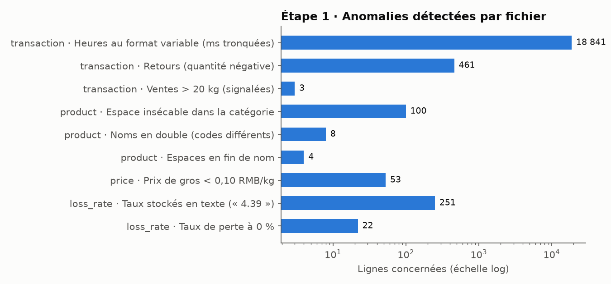
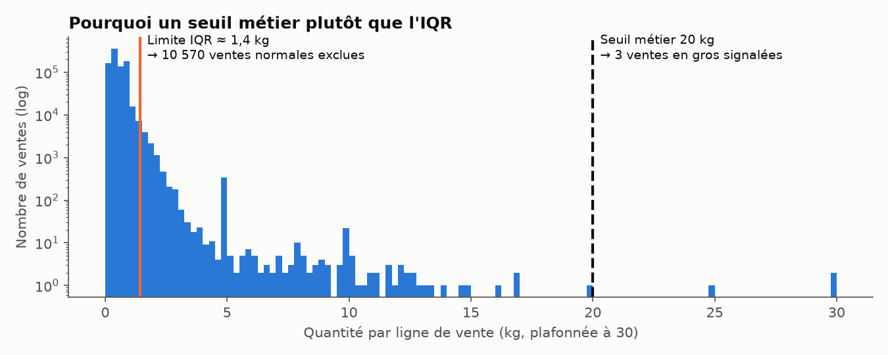
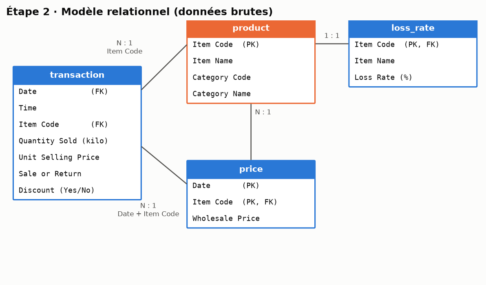
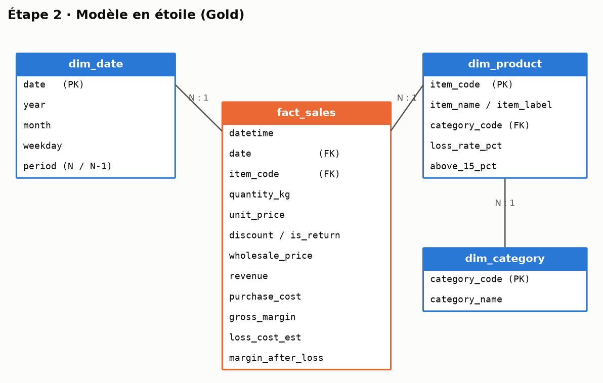
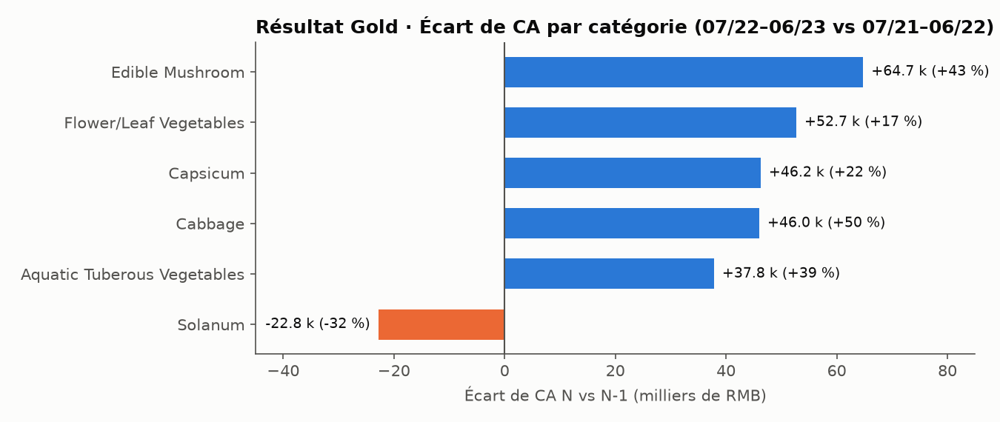

# Produits frais : analyse des ventes magasin

Exercice 2 du cours Data Analytics (Eugenia School). Ce repo transforme 4 fichiers bruts (ventes en caisse, produits, prix de gros, taux de perte) en un **modèle en étoile** propre, prêt pour le dashboard du Comex.

**Besoin métier (exercice 1).** Le directeur commercial signale que certaines catégories de produits frais sous-performent. Le Comex demande, pour les ventes magasin sur les 12 derniers mois : **CA, marge et volume**, avec l'**écart en valeur** et l'**évolution en %** par rapport à N-1. Il fixe un seuil d'alerte à **15 %**.

> ⚠️ Les données s'arrêtent au **30/06/2023**. La période « N » est donc **07/2022 → 06/2023**, comparée à **07/2021 → 06/2022**.

## Lancer le pipeline

```bash
python3 -m venv .venv && .venv/bin/pip install -r requirements.txt
# déposer les 4 CSV fournis dans data/raw/ (non versionnés)
.venv/bin/python run_pipeline.py      # Bronze -> Silver -> Gold
.venv/bin/python src/make_images.py   # régénère les images de ce README
```

```
data/raw/     Bronze : fichiers bruts reçus, jamais modifiés
data/silver/  Silver : un fichier nettoyé par source (src/clean_*.py)
data/gold/    Gold   : modèle en étoile + vue KPI (src/build_gold.py)
```

Les données ne sont pas versionnées : leurs droits de diffusion ne sont pas vérifiés et `transaction.csv` pèse 52 Mo.

---

## Étape 1 : diagnostic et rôles

Chaque membre de l'équipe est responsable d'un fichier, d'un script et d'une branche :

| Membre | Fichier | Script | Branche |
|---|---|---|---|
| 1 | transaction.csv (878 503 lignes) | `src/clean_transaction.py` | `feature/clean-transaction` |
| 2 | product.csv (251 lignes) | `src/clean_product.py` | `feature/clean-product` |
| 3 | price.csv (55 982 lignes) | `src/clean_price.py` | `feature/clean-price` |
| 4 | loss_rate.csv (251 lignes) | `src/clean_loss_rate.py` | `feature/clean-loss-rate` |



### Ce qui a été nettoyé, et pourquoi

**transaction.csv**
| Constat | Action | Justification métier |
|---|---|---|
| Heures avec un nombre variable de millisecondes (`09:55:08.28`) | Fusion date + heure en un vrai horodatage | Permet d'analyser par heure ou par jour sans erreur de tri sur du texte |
| 461 retours, déjà en quantité négative | Gardés, avec une colonne `is_return` | Un retour annule une vente : il doit venir en **déduction** du CA, pas disparaître |
| `Discount` en texte Yes/No | Converti en booléen | Filtre direct dans le dashboard |
| 3 ventes de plus de 20 kg (jusqu'à 160 kg) | Signalées (`bulk_sale`), pas supprimées | Ce sont probablement des ventes en gros réelles ; on laisse le dashboard choisir de les exclure |
| Contrôles | Aucun doublon, aucun prix ≤ 0, aucune vente en quantité négative | Vérifiés par `assert` : le script s'arrête si une règle est violée |

**Pourquoi pas la règle IQR du cours ?** Appliquée aux quantités, la limite Q3 + 1,5 × IQR tombe à environ 1,4 kg. Elle classerait **10 570 ventes normales** comme aberrantes (un sac de 2 kg de pommes de terre, par exemple). Nous avons donc retenu un seuil métier de 20 kg.



**product.csv**
| Constat | Action | Justification métier |
|---|---|---|
| 100 catégories « Flower/Leaf Vegetables » écrites avec un espace insécable | Remplacé par un espace normal | Sinon la catégorie existe en deux versions et disparaît des filtres |
| 4 noms avec un espace en fin | Espaces retirés | Même raison |
| 4 noms partagés par 2 codes (Broccoli, Chinese Cabbage…) | Ajout d'un `item_label` unique (nom + 4 derniers chiffres du code) | Deux produits différents ne doivent pas fusionner dans un graphique ; on agrège toujours par **code** |

**price.csv**
| Constat | Action | Justification métier |
|---|---|---|
| Dates en texte | Converties en date | Jointure avec les ventes sur (date, produit) |
| 53 prix de gros sous 0,10 RMB/kg (jusqu'à 0,01) | Remplacés par le dernier prix connu du produit (`price_imputed` = True) | Un coût d'achat quasi nul gonfle artificiellement la marge |
| Contrôle | Un seul prix par jour et par produit | Sinon la jointure dupliquerait des ventes |

**loss_rate.csv**
| Constat | Action | Justification métier |
|---|---|---|
| Les 251 taux sont du texte suivi d'un espace (`"4.39 "`) | Convertis en nombre, contrôle entre 0 et 100 | Indispensable pour tout calcul |
| `Item Name` en double avec product.csv (vérifié identique) | Colonne supprimée | Une seule source de vérité pour le nom |
| 22 produits à 0 % de perte | Gardés, signalés (`loss_rate_to_check`) | 0 % de perte sur du frais est peu crédible : à vérifier avec le métier |
| Seuil Comex | Colonne `above_15_pct` (29 produits) | Le Comex considère problématique une perte supérieure à 15 % |

---

## Étape 2 : modèle de données

### Modèle relationnel (tables brutes)

`Item Code` relie les 4 fichiers. Le prix de gros se joint aux ventes sur **(Date, Item Code)**, car il change chaque jour. La couverture des clés est de 100 % : aucune vente sans produit, ni sans prix de gros du jour.



### Modèle en étoile (Gold)

- **Table de faits `fact_sales`** : une ligne par article scanné en caisse. Elle contient les **mesures additives** : quantité, CA, coût d'achat, marge.
- **Dimensions** : les axes d'analyse.
  - `dim_date` : année, mois, jour de la semaine, période N / N-1.
  - `dim_product` : nom, libellé, taux de perte, drapeau > 15 %.
  - `dim_category` : les 6 catégories.

Le taux de perte est rangé dans `dim_product`, car c'est une caractéristique du produit et non de la vente. Son **coût**, en revanche, est calculé ligne par ligne dans la table de faits.



| Mesure (`fact_sales`) | Formule |
|---|---|
| `revenue` (CA) | quantité × prix de vente |
| `purchase_cost` | quantité × prix de gros du jour |
| `gross_margin` | CA − coût d'achat |
| `loss_cost_est` | coût d'achat × p / (1 − p), où p = taux de perte. Pour vendre 1 kg, il faut en acheter 1 / (1 − p). |
| `margin_after_loss` | marge brute − coût estimé des pertes |

---

## Étape 3 : code de nettoyage et de consolidation

| Script | Rôle |
|---|---|
| `src/clean_*.py` | Bronze → Silver, un script par fichier (étape 1) |
| `src/build_gold.py` | Silver → Gold : jointures `merge(..., validate=...)` et vue `kpi_category_n_vs_n1.csv` |
| `run_pipeline.py` | Lance tout dans l'ordre |

Contrôles de cohérence dans le code :
- `validate="1:1"` / `"m:1"` sur chaque jointure ;
- le nombre de lignes de ventes est identique avant et après jointure ;
- aucun prix de gros manquant après jointure ;
- aucun produit sans taux de perte.

### Résultat : vue consolidée N vs N-1



| Catégorie | CA N (RMB) | Écart CA | Évol. CA | Marge brute N | Évol. marge | Volume N (kg) | Évol. volume |
|---|---:|---:|---:|---:|---:|---:|---:|
| Flower/Leaf Vegetables | 360 042 | +52 663 | +17,1 % | 146 334 | +19,0 % | 78 898 | +64,1 % |
| Capsicum | 255 860 | +46 227 | +22,1 % | 110 147 | +56,6 % | 43 417 | +102,1 % |
| Edible Mushroom | 214 752 | +64 746 | +43,2 % | 77 073 | +39,9 % | 32 533 | +100,2 % |
| Cabbage | 138 240 | +45 966 | +49,8 % | 49 919 | +68,0 % | 14 928 | +52,9 % |
| Aquatic Tuberous Vegetables | 135 702 | +37 789 | +38,6 % | 43 692 | +48,1 % | 16 611 | +40,5 % |
| **Solanum** | **49 676** | **−22 838** | **−31,5 %** | 19 378 | −24,8 % | 5 513 | −30,8 % |
| **Total** | **1 154 272** | **+224 553** | **+24,2 %** | 446 543 | +33,9 % | 191 900 | +66,4 % |

**Premières pistes pour l'exercice 3 :**
1. **Solanum** est la seule catégorie en recul, en CA comme en volume (environ −31 %).
2. **Flower/Leaf** : le volume progresse de +64 % mais le CA seulement de +17 %, donc le prix moyen au kg baisse. La catégorie regroupe aussi **18 des 29 produits** dont la perte dépasse 15 %, soit environ 24 k RMB de pertes estimées sur N.

---

## Étape 4 : stratégie Git

```
main      ●─────────────────────────────────────────●   code validé, publié
           \                                       /
develop     ●──M──M──M──M──────────M──── README ──●     intégration
               │  │  │  │          │
feature/clean-product  │  │        │
feature/clean-loss-rate│  │        │
feature/clean-price ───┘  │        │
feature/clean-transaction─┘        │
feature/gold-model ────────────────┘
```

- Chaque fichier de nettoyage est un **script séparé** : les 4 branches ne modifient jamais le même fichier, donc les fusions se font **sans conflit**.
- Les branches sont fusionnées dans `develop` avec `--no-ff`, ce qui garde la trace de chaque contribution dans l'historique.
- `main` ne reçoit que `develop`, une fois le pipeline complet testé de bout en bout.
